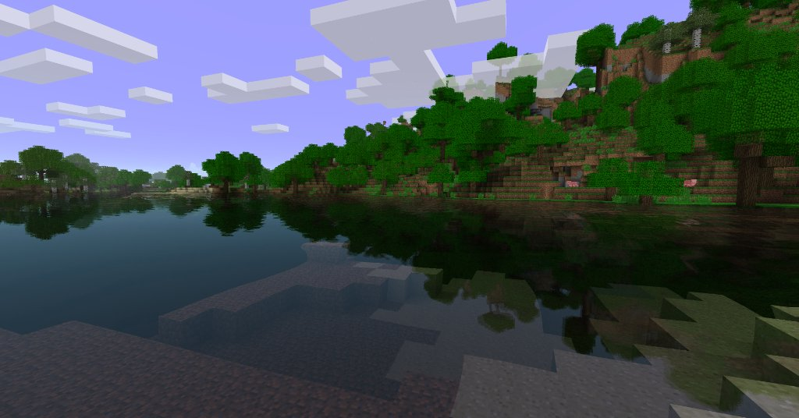

# Water Shader Unleashed

A native Babric / StationAPI (`b1.7.3`) port and modernization of **Water Shader v4c**, built for **Beta Unleashed 2.0**.



## Features
- **Multi-Pass Planar Water Pipeline**: Supersampled main scene capture (`colorMap`), normal-encoded water stencil pass (`stencilMap`), and exact-height oblique-clipped planar reflection pass (`reflectedColorMap`).
- **True Depth-Based Optical Absorption & Soft Shorelines**: Captures opaque seabed depth alongside water surface depth for crystal-clear shorelines, Beer-Lambert deep ocean absorption, and softened shoreline contacts.
- **Classic Surface Aesthetics & Smooth Flow Transitions**: Preserves Water Shader v4c's animated two-layer sine-wave ripples and crisp horizon reflections while smoothly blending horizontal and vertical flowing-to-static boundaries with watertight fluid edges.
- **Seamless Horizon Fog Fade**: Dissolves distant still-water ripples and reflections cleanly into Minecraft's live horizon fog.
- **Isolated `1×1` Reflection Suppression & View-Weighted Pond Detection**: Suppresses planar reflections on isolated single-block puddles (requiring at least 2 connected open-still water blocks) and smoothly transitions active planar reflection height toward ponds in view.
- **Modern Cave & Enclosed Water**: Replaces blocky vanilla water textures in caves and enclosed rooms with a smooth, pixel-free aqua-teal surface, animated multi-octave liquid ripples, and viewing-angle Fresnel depth glazing—strictly lit by torches/lava with zero artificial cave glow and matching cave flowing water.
- **Optional Biome-Aware Water Tinting**: Smoothly shifts water tint per Beta 1.7.3 biome (`Off` / `Subtle` / `Vivid`) as you travel between swamps, rainforests, deserts, and tundras.
- **Rain-Aware Reflections, Weather & Particles**: Isolates modern rain streaks and water-harmonized splash/bubble particles from surface refraction, adds organic raindrop ripples and rain-softened reflections outdoors, and preserves un-distorted held items.
- **Underwater Tint & Wobble**: Smooth submersion transition with distance-aware underwater fog, gentle refraction wobble, and first-person hand protection.
- **GlassConfigAPI 3 Integration & Presets**: Full live in-game configuration via ModMenu + GlassConfigAPI 3 (`config/watershader/config.yml`), including one-click look/performance presets (`Custom`, `Classic v4c`, `Modern Balanced`, `Crystal Tropical`, `Performance`), with no restart required.
- **High-Performance GPU Optimizations**: Blits Pass 0 depth directly into Pass 1 (skipping opaque Layer 0 and entity redraws on OpenGL 3.0+/ARB/EXT), automatically skips Pass 2 planar reflections in Overworld caves when no sky-exposed water is visible, offers optional `Native 1x` stencil scaling, and captures Layer 1 geometry alongside Amphetamine and StationAPI.

## Configuration (`config/watershader/config.yml`)
Managed by **GlassConfigAPI 3** and editable live in-game via **ModMenu -> Water Shader Unleashed -> Configure**:

### General
| Option | Default | Description |
|---|---:|---|
| **Water Preset** (`waterPreset`) | `Custom` | `Custom`, `Classic v4c`, `Modern Balanced`, `Crystal Tropical`, or `Performance` |
| **Water Mode** (`waterMode`) | `Reflect & Refract` | `Off` (`0`), `Refraction Only` (`1`), or `Reflect & Refract` (`2`) |
| **Reflection Resolution** (`reflectionResolution`) | `Full` | Reflection FBO scale: `Full` (1/1), `Half` (1/2), or `Quarter` (1/4) |
| **Anti-Aliasing** (`antiAliasing`) | `2` | Internal supersampling multiplier (`1..4`) |
| **Underwater Effect** (`underwaterEffect`) | `true` | Enable shader underwater fog tint and gentle refraction wobble |

### Performance
| Option | Default | Description |
|---|---:|---|
| **Fast Stencil Depth-Blit** (`fastStencilDepthBlit`) | `true` | Reuse Pass 0 depth in Pass 1 to skip redrawing opaque terrain and entities |
| **Skip Cave Reflections** (`skipCaveReflections`) | `true` | Skip Pass 2 planar reflections when only unlit cave water is visible |
| **Stencil Resolution** (`stencilResolution`) | `Match Main` | `Match Main` (sharpest edges) or `Native 1x` (saves fill-rate when AA >= 2) |

### Reflections
| Option | Default | Description |
|---|---:|---|
| **Reflective Entities** (`reflectiveItems`) | `true` | Reflect mobs, dropped items, and non-player entities in water |
| **Reflect Local Player** (`reflectPlayer`) | `true` | Reflect the local player model in water |
| **Reflective Clouds** (`reflectiveClouds`) | `false` | Reflect clouds in water |
| **Fresnel Strength** (`fresnelStrength`) | `1.0` | Viewing-angle reflection & Fresnel curve multiplier (`0.0..4.0`) |
| **Ripple Strength** (`rippleStrength`) | `1.0` | Surface wave distortion multiplier (`0.0..4.0`) |
| **Rain Ripples & Blur** (`rainRipples`) | `true` | Enable raindrop rings and rain-softened reflections outdoors |

### Surface & Waterfalls
| Option | Default | Description |
|---|---:|---|
| **Classic v3 Brightness Lift** (`renderV3`) | `true` | Enable v3 open-sky brightness lift on water surfaces |
| **Water Surface Transparency** (`waterSurfaceTransparency`) | `0.1` | Still-water surface alpha (`0.0..1.0`) |
| **Waterfall Transparency** (`waterfallTransparency`) | `0.35` | Flowing slope / waterfall alpha (`0.0..1.0`) |
| **Waterfall & Cave Fog** (`waterfallFog`) | `true` | Enable fog attenuation on waterfalls and cave water |
| **Depth-Based Absorption** (`depthAbsorption`) | `true` | Enable Beer-Lambert water depth absorption & soft shoreline fade |
| **Depth Absorption Strength** (`depthAbsorptionStrength`) | `1.0` | Optical density multiplier for deep water absorption (`0.0..3.0`) |
| **Horizon Fog Fade** (`horizonFogFade`) | `true` | Dissolve distant still-water ripples and reflections into horizon fog |
| **Modern Cave Water** (`modernCaveWater`) | `true` | Smooth glassy cave water with multi-octave ripples |
| **Excluded Blocks** (`excludeList`) | *(empty)* | Block IDs or translation keys excluded from water shader effects |

### Colors
| Option | Default | Description |
|---|---:|---|
| **Biome Water Tinting** (`biomeTintMode`) | `Off` | Smooth per-biome water color shifting: `Off`, `Subtle`, or `Vivid` |
| **Water Color - R / G / B** | `0.0` / `0.5` / `0.35` | Deep water / palette harmonization RGB tint (`0.0..2.0`) |
| **Waterfall Color - R / G / B** | `1.0` / `1.0` / `1.0` | Multiplicative waterfall RGB tint (`0.0..2.0`) |

## Keybinds
- **`F9` (`Toggle Water Shader`)**: Toggles Water Shader rendering ON/OFF live in-game (when Water Mode is not `Off`).
- **`Reload Water Shaders`** *(unbound by default — assignable in Controls)*: Hot-reloads all 4 GLSL programs from `config/watershader/shaders/` (or bundled resources) live in-game without restarting; keeps previous shaders active if an override has a syntax error.
- **`Water Stencil Debug`** *(unbound by default — assignable in Controls)*: Toggles the raw `stencilMap` visualization overlay in-game.

## Installation
- **Requirements**: Minecraft `1.7.3` Beta Unleashed 2.0 (latest version as of 11/26) — includes StationAPI, **GlassConfigAPI 3** (`>= 3.2.1`), and ModMenu Babric.
- Drop `watershader-unleashed-1.2.0.jar` into your instance's `mods/` folder.
- *(Beta Unleashed 2.0)*: Disable any conflicting shader pipeline mod (e.g., `Macula`) if present.

## Building from Source
Requires JDK 17+ (produces Java 17 bytecode):
```bash
./gradlew clean check build
```
The remapped release jar is generated at `build/libs/watershader-unleashed-1.2.0.jar`.

## License & Credits
- Licensed under the [MIT License](LICENSE).
- Ported and modernized by **Wlx**; inspired by **Necro's** original Minecraft Beta 1.7.3 **Water Shader v4c**.
